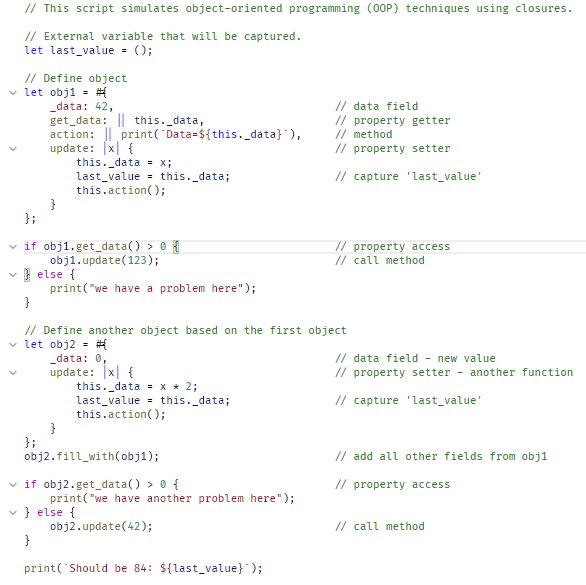

Rhai Language Support for Visual Studio Code
===========================================

[Rhai](https://rhai.rs) is an embedded scripting language and evaluation engine for Rust that gives
a safe and easy way to add scripting to any application.

Features
--------

- [x] Syntax highlighting
- [x] Grain bytecode compile
  - [x] Compile on Save
  - [x] Nested Grain bytecode file under Rhai files
  - [x] Showing compilation Errors

Todo List
---------

- [ ] Auto formatter
- [ ] Language server

How to Install
--------------

- Search for `Rhai Language Support` in Visual Studio Code.

- Download directly from the [Visual Studio Marketplace](https://marketplace.visualstudio.com/items?itemName=rhaiscript.vscode-rhai).

Commands
--------------
Use <kbd>Ctrl + Shift + P</kbd> or <kbd>Command + Shift + P</kbd> to open the command palette and type `Rhai:`.

| Command |  description |
| --- | --- |
| `rhai.compileGrain` | Compile Rhai current file to Grain bytecode |
| `rhai.format` | Rhai: Format File |
| `rhai.syntaxCheckRhai` | Rhai: Syntax check on current Rhai file |

Settings
--------------
Use the Settings panel or <kbd>settings.json</kbd> in Visual Studio Code or <kbd>command</kbd> + <kbd>,</kbd> (Windows / Linux: File -> Preferences -> User Settings) open the vscode file `settings.json`

| | type | default | description |
| --- | --- | --- | --- |
| `rhai.compileGrainOnSave`| string | `off` | Compile Rhai files to Grain bytecode on save |
| `rhai.promptFileNesting` | boolean | `true` | Prompt to ask if the Rhai file nesting should be enabled, so compiled .rgrn files can nest under their .rhai source. |
| `rhai.trace.server` | string | `off` | Traces the communication between VS Code and the language server. |
| `rhai.syntaxCheckRhaiOnChange` | string | `currentFile` | Enable syntax check on Rhai file on file change. |
| `rhai.syntaxCheckRhaiDelaySeconds` | number | `3` | Seconds to wait after typing stops before running syntax check. |
| `rhai.useLanguageServer` | boolean | `true` | Use Rhai Language Server. (WIP) |

Screenshot
----------

